<p align="center">
  
</p>

<h1 align="center">Raahi (राही)</h1>

<p align="center">
  <b>Didi, a voice-first guide for rural students: learn without fear, then find the scholarships you can get.</b><br>
  Built to work offline on a ₹6,000–8,000 Android phone, in Hindi, Tamil, Telugu, Kannada and Malayalam.
</p>

<p align="center">
  <a href="docs/demo/raahi-demo.mp4"><b>▶ Watch the 5½-minute demo</b></a> ·
  <a href="docs/DEMO.md">Demo guide</a> ·
  <a href="docs/DATA_SOURCES.md">Data sources</a> ·
  <a href="docs/PLAN.md">Build plan</a>
</p>

Entry for the **Citi India Hackathon**, problem statement *"Reimagining Education & Economic
Empowerment for Rural India"*.

---

## The problem

A Class 10 student in a village usually has a cheap shared phone and patchy 2G. Their first
language is not English, and nobody nearby to ask. Two things go wrong:

1. **Learning stalls on a few misconceptions.** A student who believes a bulb "uses up" current
   gets every circuit question wrong. Marks show *that* they are wrong, never *why*.
2. **Money they are entitled to goes unclaimed.** Scholarship rules are spread across PDFs in
   English, and the deadlines pass. The Karnataka and NSP deadlines this year are 31 October 2026.

## What Raahi does

**Didi** is a friendly character who speaks every screen aloud and listens to answers in Hindi,
with no internet needed.

| Learn | Earn | Ask |
|---|---|---|
| A short **trap test**, with no score, finds the student's misconceptions. Didi explains each one and retries it with a *different* question, and two right answers in a row clear it. Cleared traps come back after 1, 3, 7 and 21 days. Progress is a mountain the student climbs. | **At most 6 spoken questions** decide eligibility for **11 real schemes**. Each verdict quotes the official rule, its source and the date it was checked. A step-by-step guide follows, with the official link and safe draft fields to copy. A documents checklist covers have / missing. | **Ask Didi** answers spoken questions from the lesson and the scheme rules, always with the source. If she doesn't know, she says so and sends the student to their teacher. She never guesses. |

## Screenshots

These are from the real app on a 2 GB emulator, in airplane mode, with real data.

| | | | |
|:-:|:-:|:-:|:-:|
| 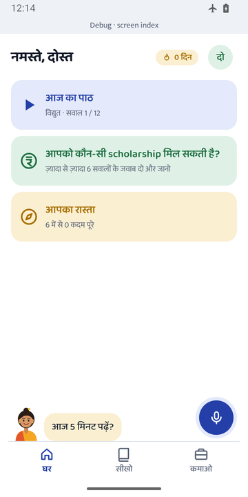<br>Home | 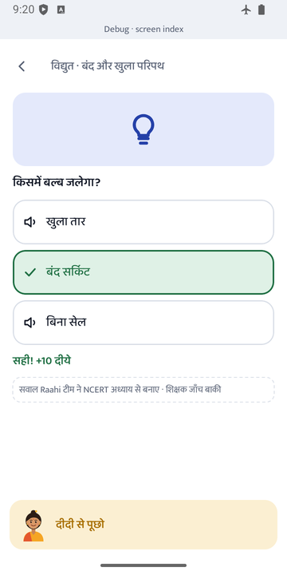<br>Lesson | 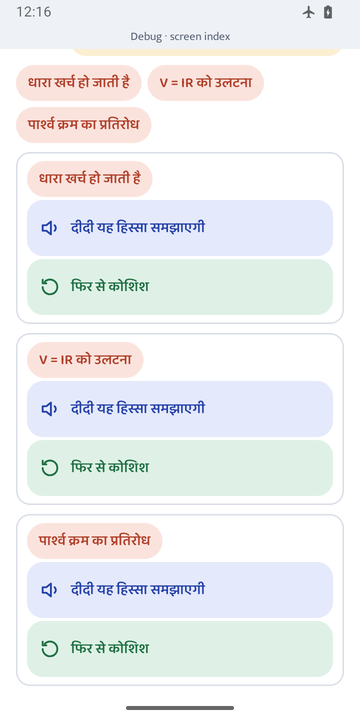<br>Traps found | 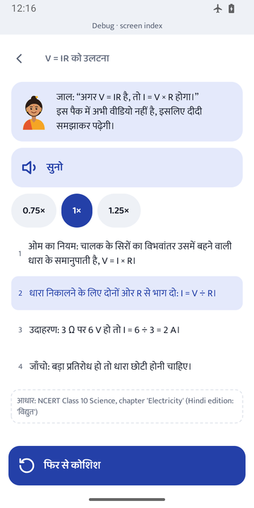<br>Didi explains |
| 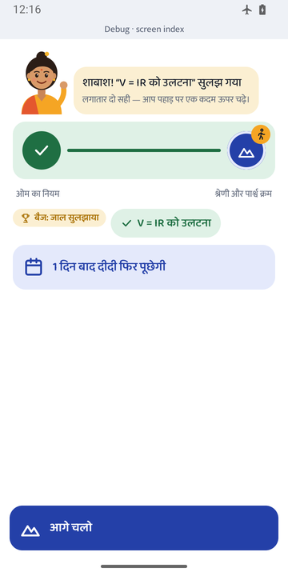<br>Trap cleared | 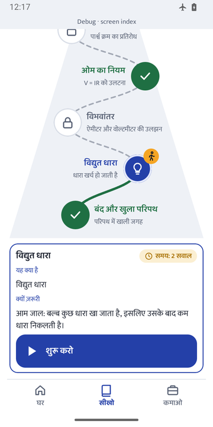<br>The mountain | 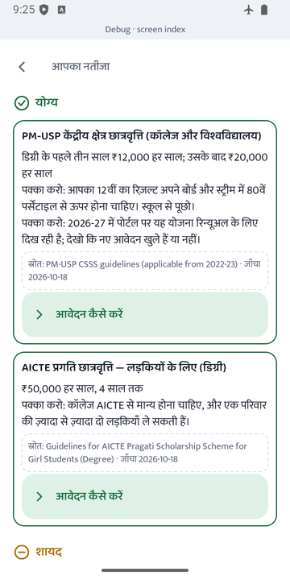<br>Scheme verdict | 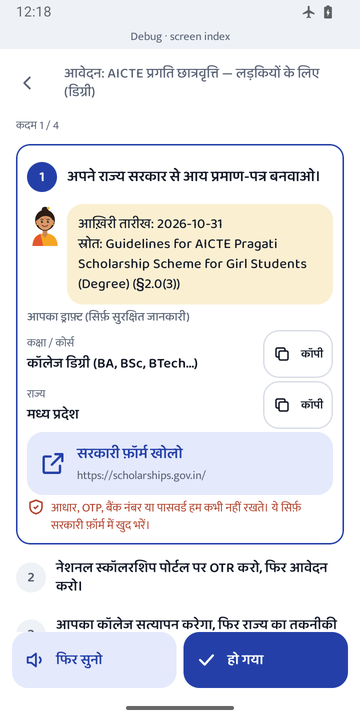<br>How to apply |
| 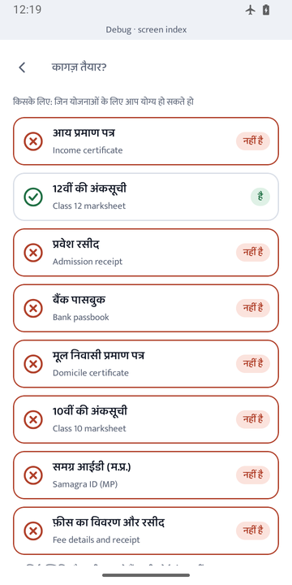<br>Documents | 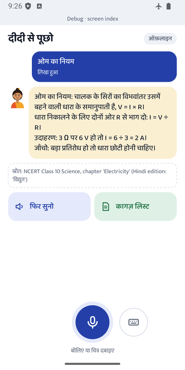<br>Ask Didi | 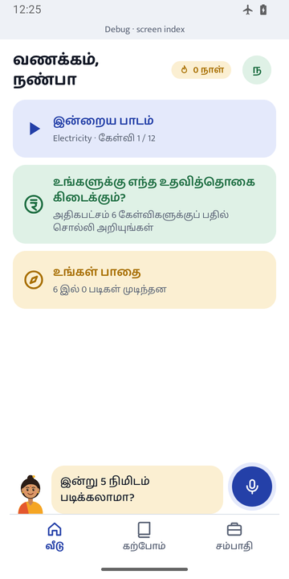<br>Same app in Tamil | 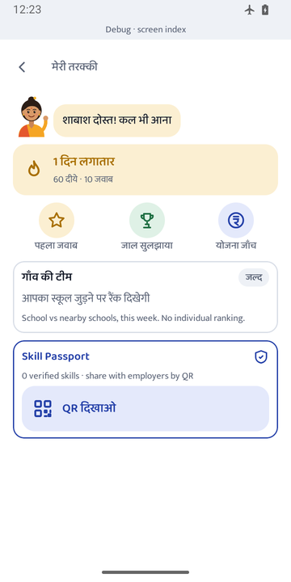<br>Progress |

## What works today

| | |
|---|---|
| **Offline** | Every screen reads from the phone. The app has **no INTERNET permission**; its only permission is the microphone. |
| **Voice** | Speech recognition runs on the phone ([Vosk](https://alphacephei.com/vosk/), small Hindi model, 42 MB pack). Voice works on every core step: language, onboarding (the name too), lesson and trap test, scheme check, apply guide ("हो गया"), and Ask Didi (free speech). Tile screens use short grammars: the tile words, spoken numbers, "पहला / दूसरा", "पता नहीं". Didi reads every question in the phone's offline Hindi voice, and every piece of text can be tapped to hear it. |
| **Learning that sticks** | A cleared trap comes back after 1, 3, 7 and 21 days ("आज दीदी 2 जाल फिर से पूछेगी"). Missing a re-check reopens the trap. |
| **Easy reading** | The app estimates reading level from how often the student taps to hear. At the low level, English sublabels disappear and Didi reads each answer option aloud with its number. There is a switch on Progress. |
| **Scheme deadlines** | Days left, counted from each scheme's official last date (for example "12 दिन बाकी"). A "maybe" verdict names the exact question still needed, and the student can answer a few more. |
| **Real data** | 11 schemes, with every rule tied to a section of the official document: NMMSS, Post-Matric SC, PM-USP CSSS, AICTE Pragati (degree and diploma), MP Medhavi, TN Pudhumai Penn and Tamil Pudhalvan, Karnataka BCWD post-matric, Telangana ePASS, Kerala e-Grantz SC/ST. [Sources →](docs/DATA_SOURCES.md) |
| **Privacy** | SQLCipher database with a random 256-bit key wrapped by Android Keystore; the file on the device contains no readable text. Income and caste are asked as **bands** and kept **on the phone only**. Aadhaar, OTPs, bank details and passwords are never asked or stored. |
| **Low-end phones** | 2 GB RAM target. The release APK is **14.9 MB** (arm64) / **12.9 MB** (armv7), checked in CI against a 25 MB budget. Picture tiles at least 48 dp; text wraps instead of being cut off in all 5 scripts. |
| **Tested** | 200+ tests. They include engine tests on the real curated rules (band edges, ≤ 6 questions, no irrelevant questions) and answer search on **real Vosk transcripts**, mistakes included. Screenshot tests cover every screen in all 5 languages. |

### Honest limits

- **Not built yet:** backend, login and sync; the online AI service; the teacher dashboard and
  tools; courses and pay-after-you-earn; NGO events. Their screens show **labelled design-reference**
  data. [Roadmap →](docs/ROADMAP.md)
- **No Andhra Pradesh scheme yet:** its official page could not be read, and we chose not to
  guess. NAPS-2 and PMKVY 4.0 are left out because their current status is unconfirmed.
- **Reviews pending:** the Raahi team wrote the Electricity questions from the NCERT chapter,
  and no teacher has reviewed them yet; the app says so on every question. Translations into
  ta/te/kn/ml are drafted and await native-speaker review ([checklist](docs/TRANSLATION_REVIEW.md)).
- **No real phone yet:** everything so far was tested on an emulator. A real 2 GB phone
  measurement (cold start, voice in a noisy room) is still to do.

## How it works

<p align="center">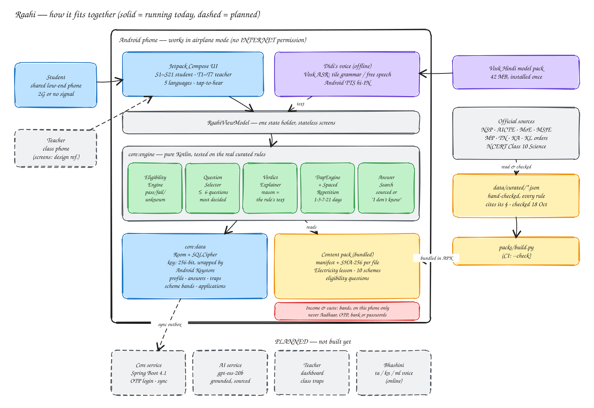</p>

Editable source: [`docs/architecture/architecture.excalidraw`](docs/architecture/architecture.excalidraw).
Open it at [excalidraw.com](https://excalidraw.com) (File → Open), or regenerate both files
with `python3 docs/architecture/build.py`.

- **Eligibility is three-valued.** A rule can pass, fail or be *unknown*. Unknown makes a
  scheme "maybe" with the missing fact named. Income bands are cut exactly at the schemes'
  thresholds (₹1, 2.5, 3.5, 4.5 and 8 lakh), so an answer always decides a rule. Where two
  schemes word a limit differently ("below ₹8 lakh" vs "₹8 lakh or less"), the shared band
  gives "maybe" instead of a wrong answer.
- **Question choice:** for every unanswered fact, the engine looks at how each possible answer
  would change the open schemes. It asks the fact expected to decide the most schemes, with
  information gain as the tie-break.
- **Traps:** every wrong option in the lesson is tagged with the misconception it shows, so a
  wrong answer becomes a diagnosis, not a mark lost.

Full design: [`docs/PLAN.md`](docs/PLAN.md) · [`docs/raahi-architecture.png`](docs/raahi-architecture.png) · UI reference: [`docs/ui-reference.html`](docs/ui-reference.html)

## Build and run

Requirements: Android SDK and Python 3.11+. JDK 21 is fetched automatically through Gradle
toolchains.

```sh
make build    # debug + release APKs (one per ABI) and the 25 MB size check
make test     # pack check, engine tests on real rules, unit + screenshot tests (5 languages)
```

Install on a phone or emulator (Android 8+):

```sh
cd apps/android && ./gradlew :app:installDebug
```

**Offline voice:** download [vosk-model-small-hi-0.22](https://alphacephei.com/vosk/models/vosk-model-small-hi-0.22.zip)
(42 MB, not in the APK), unzip it into `$DEMO_DIR/models/`, then run
`DEMO_DIR=… apps/android/tools/demo/push_model.sh`. For Didi's voice, install the Hindi voice
once under Settings → Text-to-speech. Without either, every screen still works by tapping
pictures.

**Emulator microphone (macOS):** start the emulator yourself from Terminal or Android Studio
with `-allow-host-audio`, and allow microphone access when macOS asks.

## Repository

```
apps/android     Kotlin + Jetpack Compose app
  core/model       content and scheme data classes
  core/engine      eligibility, question selection, traps, spaced repetition, answer search
  core/data        Room + SQLCipher, content-pack loader
  core/voice       Vosk recogniser, Android TTS
  core/security    database key (Android Keystore)
  core/designsystem  Didi, tiles, fonts for 5 scripts, tap-to-hear
  feature/*        screens: onboarding, home, learn, roadmap, earn, askdidi, progress, …
  i18n/*.tsv       every UI string in 5 languages → generated Android resources
data/curated     hand-checked schemes, eligibility questions, the Electricity lesson
packs/           builds the bundled content pack (manifest + SHA-256)
docs/            plan, demo guide and video, data sources, legal notes, roadmap
services/, apps/dashboard, infra/   placeholders for the backend and dashboard phases
```

## Principles

- **Real data only.** No synthetic users, records or numbers, anywhere: not in tests, demos or
  screenshots. Unknown values show "not available".
- **Never guess.** Didi answers only from sourced content, verdicts say "maybe" when a fact is
  missing, and unverifiable schemes are left out.
- **Low bandwidth first.** Screens never wait on the network.
- **Privacy by design.** No ads, no tracking, no sensitive IDs. The bands that decide eligibility
  never leave the phone.

## Licence

Apache-2.0 (see [`LICENSE`](LICENSE)). The bundled fonts are under the SIL Open Font License
(see [`NOTICE`](NOTICE)). Each scheme record links to the official government document it came
from.
